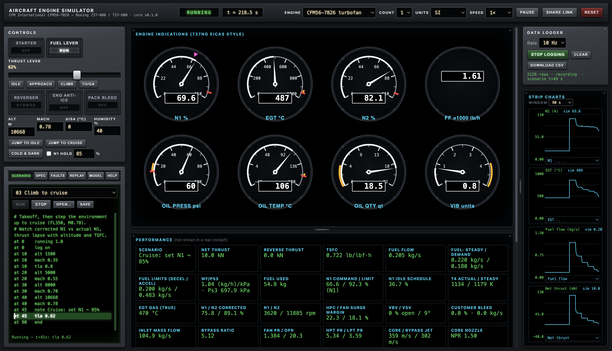

# Aircraft Engine Simulator

[](LICENSE)
[](https://aircraftengine.fly.dev)



An educational IDE for aircraft engine simulation. The simulators are
physics-based models built from the published specifications of real
engines, with virtual cockpit instrumentation and a data logger. Everything
runs inside the browser: the web server only delivers static files, and the
simulation core is Rust compiled to WebAssembly. It is a progressive web
app: after the first visit it works offline and can be installed from the
browser like a desktop or tablet app.

Five engine families and ten engines, each validated against its published
data. Try it at
https://aircraftengine.fly.dev, no install needed.

> **Educational use only.** This is a teaching tool. It is not a certified
> flight training device, not a substitute for the aircraft flight manual or
> the engine manufacturer's documentation, and must not be used for
> operational, maintenance or airworthiness decisions. The models reproduce
> published figures; the proprietary parts of the real engines (component
> maps, control laws) are replaced by calibrated approximations described in
> [docs/MODEL.md](docs/MODEL.md).

| Engine | Type | Aircraft | Rating |
|---|---|---|---|
| CFM International CFM56-7B26 | two-spool high-bypass turbofan | Boeing 737-800/900 | 26,300 lbf |
| CFM International LEAP-1B28 | two-spool high-bypass turbofan (BPR 8.6, OPR ~40) | Boeing 737 MAX 8/9 | 29,317 lbf |
| IAE V2527-A5 | two-spool turbofan (BPR 4.8, EGT read at the LPT exit) | Airbus A320-200 | 26,500 lbf |
| Pratt & Whitney PW1127G-JM | geared turbofan (BPR 12.5, 3.06:1 fan drive gearbox) | Airbus A320neo | 27,075 lbf |
| Lycoming O-360-A4M | 4-cylinder carburetted piston, fixed-pitch prop | Piper PA-28-181 Archer, Cessna 172 class | 180 hp |
| Lycoming O-320-E2D | 4-cylinder carburetted piston, fixed-pitch prop | Cessna 172M/N Skyhawk | 150 hp |
| Pratt & Whitney Canada PT6A-114A | free-turbine turboprop, constant-speed prop | Cessna 208B Grand Caravan | 675 shp |
| Pratt & Whitney Canada PT6A-42 | free-turbine turboprop, constant-speed prop | Beechcraft King Air B200 | 850 shp |
| General Electric J85-GE-5A | single-spool afterburning turbojet, variable nozzle | Northrop T-38A Talon | 2,680 lbf dry / 3,850 lbf A/B |
| Rolls-Royce (Allison) 250-C20B | free-turbine turboshaft, N2-governed rotor | Bell 206B JetRanger | 420 shp |

**What it teaches**

- Normal operation: ground start, idle, takeoff, climb, cruise, shutdown,
  with 737NG-style EICAS indications and the full station-by-station cycle
  visible next to them.
- The FADEC: N1 governing through fuel flow, Wf/Ps3 acceleration and
  deceleration schedules, flat rating (EGT-limited N1 on a hot day), idle
  schedules, bleed effects, reverse thrust.
- Abnormals: hot, hung and wet starts, compressor surge and surge cycling,
  flameout and auto-relight, windmill restart envelope, oil leak to seizure,
  fire drill, governor failure, instrument failure; all through injectable
  faults and 52 scripted lessons (15 turbofan, 6 piston, 6 turboprop, 5
  turbojet, 5 turboshaft, plus two to four per newer preset, including hot
  starts, a surge and a flameout, with checkpoints tuned to that engine).
- Assessment: `check` and `watch` lines in a lesson script set pass/fail
  criteria on any signal (EGT under the start limit, idle N1 in range, thrust
  reached within a set time) and the IDE reports the results. A check the
  script never reaches is graded as failed, so a lesson cannot pass by
  skipping the event it demonstrates; the FAR 33.73 timing itself is checked
  in the core's test suite, not in a lesson. Every
  graded run is kept in the Results tab with its engine, lesson, score and
  per-check details, and exports as CSV or JSON.
- Parametric sweeps: steady-state thrust, TSFC, EGT or any other signal
  against altitude, Mach, ISA deviation or lever position, with a second
  variable as curve family, plotted and exportable as CSV.
- Validation: replay any CSV flight log (own logger output or external data),
  drive the model from the logged levers or N1, overlay the logged channels
  on the charts and tabulate the errors.
- Twin-engine operation with per-engine lever targeting and faults.
- Piston lessons: cold start and priming, magneto check with a fouled plug,
  takeoff and climb temperatures, leaning to peak EGT at altitude,
  carburettor icing, fuel starvation and restart.
- Turboprop lessons: start, torque versus ITT limits hot and high, propeller
  governing and feather, hot start on a weak battery, reverse on the landing
  roll, flameout and relight.
- Turbojet lessons (T-38): start, military power and afterburner with the
  variable nozzle, a nozzle stuck closed with the afterburner lit, hot start,
  afterburner at altitude.
- Turboshaft lessons (JetRanger): start and rotor engagement, hover power
  with the N2 governor holding rotor speed, hot start on a weak battery,
  governor failure, flameout and autorotation (the autorotation is a prescribed
  Nr-holding torque, not a rotor inflow model: it shows the procedure, not the physics).
- The complete model documentation (equations, calibration, limits) is in
  [docs/MODEL.md](docs/MODEL.md) and in the IDE's Model tab.

```
aircraft-engine/
├── crates/
│   ├── engine-core/      Rust simulation core (no I/O, runs natively and as wasm)
│   │   ├── src/atmosphere.rs   ISA atmosphere, inlet total conditions
│   │   ├── src/spec.rs         Engine specification (ratings, geometry, cycle, limits)
│   │   ├── src/cycle.rs        Station-by-station thermodynamic cycle, nozzles, sizing
│   │   ├── src/engine.rs       Turbofan: FADEC, spool dynamics, start/shutdown, sensors, limits
│   │   ├── src/propeller.rs    Blade-element propeller with induced inflow (piston + turboprop)
│   │   ├── src/piston.rs       Lycoming O-360: induction, mixture, power, temperatures, starting
│   │   ├── src/turboprop.rs    PT6A-114A: gas generator, free power turbine, governor, start; rotor load for the turboshaft
│   │   ├── src/turbojet.rs     J85-GE-5A: single spool, afterburner, variable nozzle, hydromechanical fuel control
│   │   ├── src/any.rs          Engine-kind dispatcher (one interface for wasm and CLI)
│   │   ├── src/logger.rs       Fixed-rate CSV data logger
│   │   └── tests/              validation.rs (CFM56, 29), leap.rs (LEAP-1B, 6), presets.rs (V2500, PW1100G, O-320, PT6A-42, 10), piston.rs (11), turboprop.rs (12), turbojet.rs (7), turboshaft.rs (5)
│   ├── engine-wasm/      wasm-bindgen bindings (one Simulator type for all engine kinds)
│   └── engine-cli/       Native runner: `spec [kind]`, `design`, `point`, `run <script> [--engine kind]`
├── web/                  TypeScript IDE (Vite). Static output in web/dist
│   ├── src/worker.ts       Simulation worker (owns the wasm engines, runs the clock)
│   ├── src/sim.ts          Main-thread client for the worker
│   ├── src/kinds.ts        Per-engine descriptors: dials, controls, faults, signals, readouts, lessons
│   ├── src/signals.ts      Signal registry (chart channels, log import patterns and units)
│   ├── src/instruments.ts  Round-dial SVG instruments and the adaptive dial grid
│   ├── src/splitter.ts     Draggable splitters (charts column width, indications height)
│   ├── src/charts.ts       Strip charts with cursor and log overlay
│   ├── src/scenario.ts     Scenario script parser and runner (timed and conditional lines, checkpoints)
│   ├── src/sweep.ts        Parametric sweeps (steady-state curves on a display unit)
│   ├── src/replay.ts       CSV flight-log import, mapping, replay and comparison
│   ├── src/share.ts        Share links (compressed state in the URL fragment)
│   ├── src/markdown.ts     Renders docs/MODEL.md into the Model tab
│   ├── public/scenarios/   Lesson scripts
│   └── public/sw.js, manifest.webmanifest, icons/   Offline service worker and PWA manifest
├── docs/MODEL.md         Model documentation (equations, calibration, limits)
├── Dockerfile, fly.toml  Static-site deployment (nginx) on Fly.io
└── scripts/build-wasm.sh
```

## Build and run

Requirements: Rust (stable, with the `wasm32-unknown-unknown` target),
`wasm-bindgen-cli` matching the crate version pinned in
`crates/engine-wasm/Cargo.toml`, optionally `wasm-opt`, Node 20+.

```bash
# 1. Validate the physics natively
cargo test -p engine-core

# 2. Build the wasm module into web/src/wasm
./scripts/build-wasm.sh

# 3. Run the IDE (dev server with hot reload)
cd web && npm install && npm run dev

# 4. Production: static files only
cd web && npm run build      # -> web/dist
cd web && npm run preview    # or any static server, e.g. python3 -m http.server -d dist
```

## Deployment

The public instance at https://aircraftengine.fly.dev runs on [Fly.io](https://fly.io).
Because the simulation runs in the browser, the deployment is only a static
file server: there is no backend, no database and nothing about a session
leaves the visitor's machine.

**How it is built.** The [Dockerfile](Dockerfile) has three stages:

1. `rust:1-slim-bookworm` installs the `wasm32-unknown-unknown` target and
   the pinned `wasm-bindgen-cli`, compiles `engine-wasm` in release mode and
   generates the JS bindings.
2. `node:20-alpine` installs the web dependencies, copies the bindings and
   `docs/MODEL.md` (rendered in the Model tab), and runs `vite build`.
3. `nginx:1.27-alpine` serves `web/dist` on port 8080 with
   [deploy/nginx.conf](deploy/nginx.conf): the `application/wasm` MIME type
   (so the browser can stream-compile the module), gzip, a one-year immutable
   cache for the hashed assets and `no-cache` for `index.html`, and a
   health check on `/`.

The final image is about 18 MB. The first remote build takes several minutes
because `wasm-bindgen-cli` is compiled from source; later builds reuse that
cached layer.

**Configuration** is in [fly.toml](fly.toml): app `aircraftengine`, primary
region `yyz` (Toronto), two `shared-cpu-1x` machines with 256 MB each,
`auto_stop_machines` off and `min_machines_running = 2` so both stay up,
HTTPS forced, and an HTTP health check every 15 s. Fly's proxy balances
requests across the two machines and restarts one that fails its check.

**Commands** (requires `flyctl` and `fly auth login`):

```bash
fly deploy --ha --remote-only      # build on Fly's builder, roll out to both machines
fly status                         # machines, regions, health checks
fly logs                           # nginx access and error logs
fly scale count 2 --region yyz     # adjust the machine count
fly scale memory 512               # adjust memory per machine
fly ips allocate-v4                # dedicated IPv4 (needed only for a custom domain without CNAME)
fly certs add sim.example.com      # custom domain with automatic TLS
```

To deploy your own copy, change `app` in `fly.toml` (names are global on
Fly), run `fly apps create <name>`, then `fly deploy --ha --remote-only`. The
same `Dockerfile` runs anywhere Docker does (`docker build -t engine-sim . &&
docker run -p 8080:8080 engine-sim`), and `web/dist` can be dropped onto any
static host such as GitHub Pages, Netlify or an S3 bucket, since the build
uses relative asset paths.

Scenario scripts (see `web/public/scenarios/`) use timed and conditional
lines; `ctl <control> <value>` sets any control of the selected engine, and
`check` / `watch` lines grade the run:

```
at 0     starter on
at 18    fuel on
when n2 >= 59   note idle reached
at 70    tla 1.0
when n1 >= 95   fault surge
at 120   engine 2
at 120   fault ignition_fail on
# checkpoints: check is evaluated when its line fires, watch must hold to the end
at 18    watch egt < 725
at 90    check n1 >= 20
at 90    screenshot idle     # saves a PNG of the flight deck
# piston / turboprop controls through ctl:
at 0     ctl magnetos 3
at 2     ctl primer 3
at 0     ctl prop_lever 1
when ng >= 13   ctl condition_lever 1
```

### The IDE

The interface is laid out like a Boeing 737-800 flight deck. The top bar is
the glareshield, with the engine state and simulation time in LCD-style
windows and the engine, count, units and speed selectors. The left column
is the pedestal: lit pushbuttons for the switches (starter, fuel lever,
reverser, anti-ice, bleed, magnetos...), the thrust lever on a quadrant
track, and the environment inputs. Below it a CDU holds the scenario
editor, the spec editor, the fault panel, log replay, the model
documentation and the help. The centre and right columns are display
units: engine indications (round EICAS-style dials with white fill arc,
boxed digital readout, amber band, red line and magenta command bug),
performance readouts, cycle stations, the data logger and strip charts.

Two splitters let you rearrange the layout, and both remember their
position in the browser:

- the grip in the gap left of the strip charts sets the width of the
  right column;
- the grip under the engine indications sets their height; the dials then
  rearrange into whatever column count gives the largest instruments for
  the space (one row of eight in a short panel, three columns in a tall
  one), in single and twin-engine layouts.

Double-click a grip to return to the automatic layout. Below 1000 px the
layout changes: on a tablet the display units take the full width with
the pedestal and the charts side by side underneath; on a phone everything
stacks in one column. The Screenshot button on the glareshield saves a PNG of the whole flight deck, including
the part of the centre column scrolled out of view, named after the engine
and the simulation time; it is rendered in the browser, so nothing leaves
the machine.

While a scenario runs, the editor highlights the line of the last event
applied in white and the conditional `when` lines that are armed and
waiting in amber, and scrolls to keep the current line in view. Checkpoint
lines turn green or red as they pass or fail, with the measured value and
time in the status line, and the summary stays until the script is edited.

The parametric sweep display unit computes steady-state operating points
on a settled copy of engine 1 (the running engines are untouched) and plots
any signal against altitude, Mach, ISA deviation or lever position, with
up to six values of a second variable as separate curves. Variables not
swept stay at the current environment and lever. Results download as CSV.

Native tools without a browser:

```bash
cargo run -p engine-cli -- point 100            # turbofan takeoff point, SL static
cargo run -p engine-cli -- point 85 10668 0.78  # N1 85% at FL350 M0.78
cargo run -p engine-cli -- point 100 --engine leap1b   # same for the LEAP-1B28 (or v2500)
cargo run -p engine-cli -- spec piston          # default spec JSON of a preset: turbofan, leap1b, v2500, pw1100g, piston, o320, turboprop, pt6a42, turbojet, turboshaft
cargo run -p engine-cli -- run web/public/scenarios/01-ground-start.txt > log.csv
cargo run -p engine-cli -- run web/public/scenarios/piston-01-cold-start.txt --engine piston > log.csv
cargo run -p engine-cli -- run web/public/scenarios/turboprop-01-start.txt --engine turboprop > log.csv
```

## Architecture

The simulation runs in a dedicated Web Worker (so it is not throttled in a
background tab) and the UI renders 30 state snapshots per second. The server
only serves static files; nothing about a session leaves the browser. In
production a service worker keeps every file it has served (app shell,
wasm, lessons, model documentation) so the simulator keeps working
offline; it is network-first, so a new deployment is picked up on the
next online visit. Share
links put the scenario, spec and settings into the URL fragment; edits are
also kept in the browser's local storage.

Each engine kind is a Rust module behind the `AnyEngine` dispatcher and a
`KindDef` descriptor in `web/src/kinds.ts`; the engine selector lists the
`PRESETS` table from `any.rs`, grouped by kind, and the dial limits of
every family follow the loaded spec's limits block. The turboshaft is the
free-turbine module with a `rotor` block in its spec (a rotor load curve
and an N2 governor replace the propeller and its governor); its spec JSON
carries `kind: "turboshaft"`. Adding an engine means: a spec
struct and model in `crates/engine-core`, a variant in `any.rs`, validation
tests, and a descriptor listing its dials, controls, faults, signals,
readouts and lessons. The spec JSON carries a `kind` tag; a document without
one is read as a turbofan spec.

## What the models reproduce

**Piston (O-360, PA-28-181 POH):** full-throttle static 2,350 rpm / 160 hp /
13.6 gal/h; 8,000 ft full throttle 2,550 rpm, 72 % power, 10.6 gal/h leaned;
idle 740 rpm at 12 inHg; magneto drop ~56 rpm each; climb CHT ~365 °F, cruise
~300 °F; cold start needs prime, carburettor ice forms in the 10 °C humid band
and clears with carb heat.

**Turboprop (PT6A-114A, 208B POH):** 675 shp at 100 % Ng, takeoff ITT 684 °C
and 424 lb/h, torque 1,866 ft·lb at 1,900 rpm, static thrust ~2,600 lbf;
idle Ng 52 %, ITT ~500 °C, 136 lb/h; 10,000 ft cruise 1,390 ft·lb at 302 lb/h;
ground start ~28 s with ITT peak ~640 °C; weak-battery hot start past 1,090 °C;
torque limited at sea level, ITT limited hot and high.

**Turbojet (J85-GE-5A, T-38A flight manual and GE data):** 2,680 lbf dry and
3,850 lbf in afterburner by sizing (the nozzle throat for military power,
then the reheat fuel and the open nozzle that passes it at the same turbine
point); dry TSFC ~0.96 and ~1.9 lb/lbf/h in afterburner; military EGT
~620 °C under the 690 °C limit; idle 48 % rpm with the nozzle open;
start ~15 s fuel-on to idle; idle to military in ~3 s; a nozzle stuck
closed with the afterburner lit drives the compressor into stall.

**Turboshaft (250-C20B, Bell 206B flight manual):** 420 shp at 100 % N2 by
sizing, 100 % torque defined at that point; the N2 governor holds the rotor
at 100 % Nr (394 rpm) with a transient droop of a few percent on a quick
collective pull; hover (~55 % collective) ~290 shp at 69 % torque and
TOT ~680 °C; full collective ~100 % torque with TOT under the 810 °C
takeoff limit; start ~18 s with the rotor freewheeling at ~50 % Nr at
idle, then governed to 100 % at throttle FULL; a failed governor lets Nr
run away with collective. The rotor is a power-absorption curve, not a
blade-element rotor.

**Turbofan (CFM56-7B26):** published figures from the FAA type certificate
data sheet, the 737NG FCOM and CFM data are inputs: rated thrust, flat rating, fan diameter, mass flow,
bypass ratio, pressure ratios, N1/N2 at 100%, idle speeds, all EGT, speed and
oil limits, starter and start envelope. The validation suite checks that the
model lands on the published operating points:

| Point | Model | Published / expected |
|---|---|---|
| Takeoff thrust, SL ISA | 26,300 lbf (by sizing) | 26,300 lbf |
| Takeoff fuel flow | ~9,300 lb/h (TSFC 0.355) | ~9,000–10,000 lb/h |
| Takeoff EGT | ~857 °C | 800–900 °C (limit 950) |
| Overall pressure ratio | 32.7 | 32.7 |
| Ground idle N1 / N2 | 21 % / 60 % | 21 % / 60 % |
| Ground idle fuel flow, EGT | ~1,350 lb/h, ~450 °C | ~1,000–1,400 lb/h, 400–480 °C |
| Cruise FL350 M0.78, N1 85 % | ~4,200 lbf, TSFC 0.62 | 4,000–5,500 lbf, 0.60–0.65 |
| Flight idle to 95 % takeoff thrust (FAR 33.73(b), the applicable start point) | 4.7 s (CFM56), 4.8 s (LEAP), 4.6 s (PW1100G), 5.9 s (V2500, open item) | ≤ 5 s |
| 15 % to 95 % takeoff thrust (the rule's fallback start point) | 4.4 s (CFM56), 4.6 s (LEAP), 3.7 s (PW1100G), 5.5 s (V2500) | ≤ 5 s |
| Ground idle to 95 % takeoff thrust | ~6 s | lower start point than the rule's |
| Ground start, fuel-on to idle | ~32 s, EGT peak ~600 °C | 30–60 s, limit 725 °C |

**Presets within a family** share the family's model and calibration and
differ by their published figures: the V2527-A5 (rating, 100 % speeds, BPR
4.8, OPR ~27.5, EGT limits of 635 / 610 °C read at the LPT exit; takeoff EGT
~585 °C, TSFC ~0.37 and cruise ~0.63 lb/lbf/h), the O-320-E2D (150 hp at
2,700 rpm, 7.0:1, 75 in prop; static ~2,350 rpm, 8,000 ft cruise leaned
within the 172N POH range) and the PT6A-42 (850 shp, Ng 37,500 rpm, Np
2,000 rpm, torque 2,230 ft·lb, ITT 800 °C; takeoff torque-limited on a
standard day, low idle Ng ~60 %) and the PW1127G-JM geared turbofan (27,075
lbf, BPR 12.5, OPR 40, fan at 3,281 rpm driven through a 3.0625:1 gearbox;
the LP turbine speed is reported separately, the LP inertia is referred to
the fan; takeoff TSFC ~0.23, cruise ~0.55, no worse than the LEAP-1B in
this model). Each has its own validation tests in `presets.rs` with
deliberately wide tolerances, including a deceleration-to-idle check for
every turbofan. Adding a preset is a function that edits the family's base
spec plus a line in `PRESETS`.

The V2500 and the PW1100G also use the model's transient EGT limiting
(`egt_transient_margin_c`): within that margin of the takeoff EGT limit the
EEC blends the acceleration fuel limit down to the steady fuel, as the real
controllers do, instead of relying on the Wf/Ps3 schedule alone.

**Turbofan (LEAP-1B28):** the same model with the LEAP-1B's published
rating, geometry, 100 % speeds, bypass ratio 8.6, pressure-ratio class and
limits (FAA TCDS E00088EN, 737 MAX FCOM, CFM data); the calibration knobs
start from the CFM56-7B26 and are adjusted for the higher-pressure,
two-stage-HPT cycle. Checked points: rated thrust 29,317 lbf by sizing;
takeoff TSFC ~0.28 lb/lbf/h and EGT ~900 °C (limit 1,038 °C); cruise FL350
M0.78 TSFC ~0.55, about 11 % below the CFM56-7B26 (published ~15 %); ground
start and FAR 33.73 acceleration within limits.

Known calibration gaps: the PW1127G-JM airflow (540 kg/s) is chosen so the
sizing lands on the rating with a plausible turbine temperature, since
P&W does not publish it; the V2527-A5 takes ~9 s from ground idle to 95 %
thrust, about a second more than the real engine, because its EEC trims
fuel as the LPT-exit EGT approaches the 635 °C limit and the model trades
the last second of spool-up for staying under that limit.

## What is approximated

Component maps (fan, booster, HPC, turbines) and the FADEC control laws are
proprietary. They are replaced by:

- power-law component characteristics against corrected speed, calibrated to
  the published points above;
- a steady-state N2(N1) relation fitted to cockpit indications;
- turbine inlet temperature fixed by core-nozzle flow continuity (the same
  physical constraint that fixes it in the real engine);
- a fuel-based FADEC: proportional N1 governor with feed-forward, clamped by
  Wf/Ps3 acceleration and deceleration schedules; the LP spool integrates the
  resulting turbine power surplus, the HP spool follows its operating line.

The whole model is in the JSON spec shown in the IDE, so every assumption can
be inspected and changed.

## Sources

The published figures behind the calibrations come from the FAA type
certificate data sheets (E00055EN for the CFM56-7B, E-286 for the O-360,
E4EA for the PT6A), the Boeing 737NG FCOM limitations and engine indication
chapters, the Piper PA-28-181 and Cessna 208B pilot's operating handbooks,
the Lycoming O-360 operator's manual, manufacturer-published performance data
and FAR Part 33. No proprietary data is included. Trademarks (CFM, Lycoming,
Pratt & Whitney Canada, Boeing, Piper, Cessna) belong to their owners and are
used only to identify the engines and aircraft modelled.

## Contributing

Issues and pull requests are welcome; see [CONTRIBUTING.md](CONTRIBUTING.md).
Questions, teaching ideas and show-and-tell go in GitHub Discussions. Real
flight logs you are allowed to share are the most valuable contribution.

## License

MIT, see [LICENSE](LICENSE). Copyright (c) 2026 Andre Paquette.
